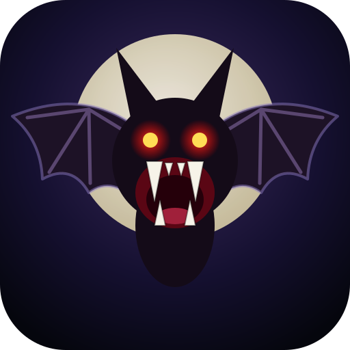

# Noc Nietoperzy

Mroczna gra FPP w czerni i bieli, w układzie pionowym. Gracz stoi w miejscu, nocą w transylwańskim lesie, a nietoperze lecą w jego stronę.

## Broń
Broń zmieniasz przyciskami na dole ekranu: lewy to czosnek, prawy to dzida. Na klawiaturze działają też strzałki ← → oraz klawisze 1 i 2.

- **Czosnek:** każde dotknięcie to jeden rzut po łuku. Masz najwyżej 10 główek, a co 1,5 s przybywa jedna.
- **Dzida:** dotknięcie to pchnięcie w wybrane miejsce. Dzida jest bez limitu, ale sięga tylko nietoperzy, które są blisko.

## Zasady
- Nietoperz, którego nie zabijesz, podlatuje i kąsa co 0,5–0,8 s. Zanim ugryzie, widać z bliska jego otwartą paszczę z białymi kłami.
- Przy ugryzieniu ekran na chwilę robi się czerwony. To jedyny kolor w grze.
- **10 ugryzień = śmierć.** Zdrowie pokazuje pasek nad przyciskami broni.
- Z czasem nietoperzy jest coraz więcej i lecą coraz szybciej.

## Uruchomienie
Otwórz `index.html` w przeglądarce. Gotyckie czcionki (Pirata One, UnifrakturMaguntia) ładują się z Google Fonts. Bez internetu gra działa ze zwykłą czcionką.
